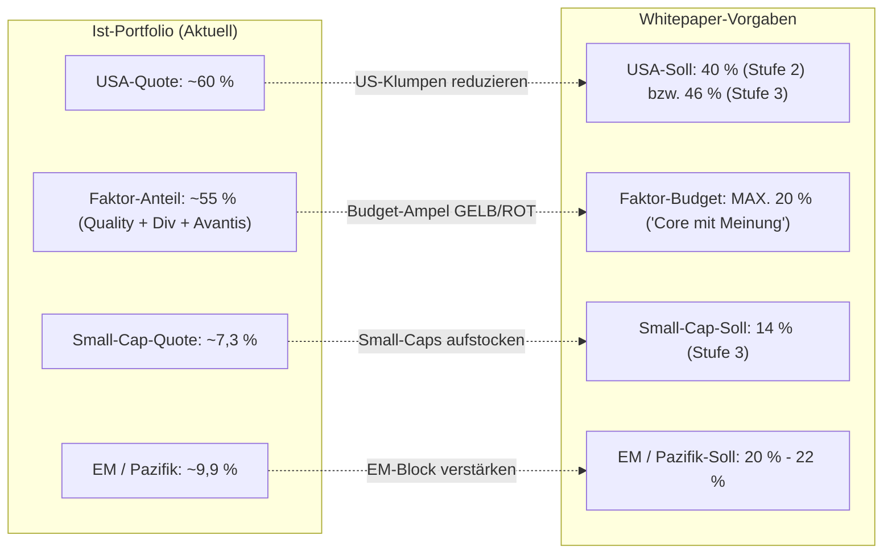
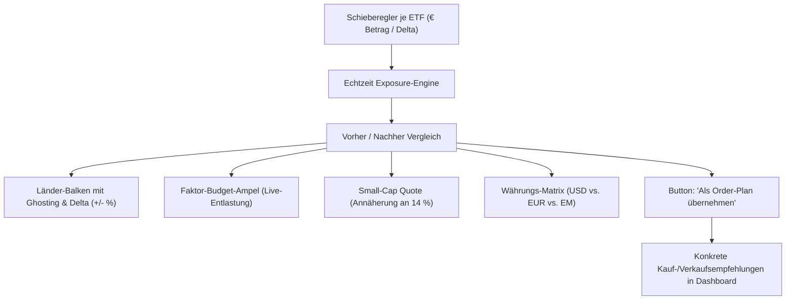

# Feature-Konzept: Core-Analyse, Steuerung & Interaktiver What-If Simulator

> **Ausrichtung & Kontext:** 
> - **Ziel:** Analyse der 7 tatsächlichen Core-ETFs des Anlegers über eine Schnittstelle auf Länder-, Währungs-, Size- und Faktor-Ebene sowie der Abgleich mit den Soll-Vorgaben aus dem Leitfaden *„Core-Satellite-Strategie“*.
> - **Simulator:** Ein interaktiver **What-If Simulator mit Schiebereglern** für jeden einzelnen ETF mit Live-Rückmeldung auf alle Exposures (Vorher/Nachher-Delta).
> - **Soll-Orientierung:** **Stufe 2 (Standard-Baukasten 40/40/20)** und **Stufe 3 (Regionaler Baukasten + Small-Caps)** sowie das **20 % Faktor-Budget („Core mit Meinung“)**. Die Ein-ETF-Lösung (100 % All-World) ist explizit **ausgeschlossen**.

---

## 1. Die tatsächliche Ist-Zusammensetzung (Screenshot-Analyse)

Aus dem beigestellten Screenshot ergeben sich 7 reale Core-Positionen mit einem Gesamtwert von **~20.606,15 €**:

| Position (lt. Screenshot) | Typ | Ist-Wert (€) | Ist-Anteil Core | Vermutete ISIN | Primärer Charakter / Tilt |
|---|---|---|---|---|---|
| **ISHARES EDGE MSCI WLD QUAL FCTR** | ETF | 9.822,27 € | **47,7 %** | `IE00BP3QZ601` | Faktor: **Quality** (starker US-Tilt ~73 %) |
| **XTRACKERS MSCI WORLD ETF** | ETF | 7.241,85 € | **35,1 %** | `IE00BJ0KDQ90` | Standard Welt (Large/Mid DM, ~71 % USA) |
| **SPDR S&P PAN ASIA DIV ARISTOCRATS** | ETF | 1.137,62 € | **5,5 %** | `IE00B9KNR336` | Region Asien/Pazifik + Faktor: **Dividende/Value** |
| **XTRACKERS MSCI EUROPE SMALL CAP** | ETF | 1.367,90 € | **6,6 %** | `LU0322253906` | Region Europa + Size: **Small Cap** |
| **XTRACKERS S&P SELECT FRONTIER SW** | ETF | 591,10 € | **2,9 %** | `LU0328476410` | Region: **Frontier Markets** (Vietnam, Kasachstan, etc.) |
| **AVANTIS GLOBAL SMALL CAP** | ETF | 144,62 € | **0,7 %** | `IE0003R88KJ0` | Size: **Small Cap** + Faktoren: **Value & Profitability** |
| **AVANTIS EMERGING MARKETS** | Fonds/ETF | 300,79 € | **1,5 %** | `IE0002652NZ2` | Region: **Schwellenländer** + Faktor: **Value** |
| **Gesamt Core** | | **20.606,15 €** | **100,0 %** | | |

---

## 2. Der Ist-Soll-Vergleich gegen das Whitepaper

Vergleicht man diese Ist-Zusammensetzung mit den Leitfaden-Vorgaben, treten sofort vier zentrale Diskrepanzen zutage:



1. **USA-Konzentration:** Reales US-Exposure bei **~59,7 %** (vs. Soll Stufe 2: **40 %** / Stufe 3: **46 %**).
2. **Faktor-Budget-Verletzung (Seite 11 des Leitfadens):** Faktor-Anteil bei **über 55 %** des Cores (vs. Soll: **maximal 20 %**).
3. **Size-Faktor (Small Caps):** Nur **7,3 %** Small Caps (vs. Soll Stufe 3: **14 %**).
4. **Schwellenländer & Asien:** Nur **9,9 %** inkl. Frontier & Asia (vs. Soll: **20 % bis 22 %**).

---

## 3. Der Interaktive What-If Simulator (Kernkomponente)

Der Simulator ermöglicht es, spielerisch und mit sofortigem visuellen Feedback Kauf- und Verkaufsentscheidungen durchzuspielen.



### 3.1 Die Funktionsweise des Simulators:
* **Zwei Arbeitsmodi:**
  1. **Modus A: Reines Umschichten (Cash-neutral):** 
     - Verkäufe (z. B. `-2.500 €` im MSCI World Quality) fließen in ein dynamisches *„Verfügbares Rebalancing-Budget“*. 
     - Dieser Betrag kann dann gezielt auf andere ETFs verteilt werden (z. B. `+1.500 €` in Avantis EM und `+1.000 €` in Avantis Small Cap), ohne frisches Geld einzuzahlen.
  2. **Modus B: Frisches Kapital (Sparplan / Zukauf):**
     - Simuliert die Zufuhr von frischem Cash (z. B. `+1.200 €` aus dem Core-First Signal).
* **Steuerungselemente je ETF:**
  * Feinfühliger **Schieberegler**: Delta von `-100 %` (Vollverkauf) bis `+200 %` (Aufstockung).
  * Direkte **Euro-Zahleneingabe** für exakte Beträge.
  * **Quick-Buttons**: `+250 €`, `+500 €`, `+1.000 €`, `-500 €`, `Vollverkauf`.
* **Sofortige Live-Visualisierung („Vorher vs. Nachher“):**
  * **Länder-Vergleich:** Jeder Länderbalken zeigt den bisherigen Ist-Stand als Referenzlinie und den neuen simulierten Stand mit farbiger Differenz-Pille (z. B. `USA: 59,7 % ➔ 47,1 %  [-12,6 %]  Ziel: 46,0 % ✓`).
  * **Faktor-Budget Live-Ampel:** Zeigt sofort, wie z. B. der Verkauf von Quality-Anteilen die Budget-Ampel von Rot auf Grün schaltet: `Faktor-Quote: 55,2 % ➔ 19,4 % (Budget eingehalten ✓)`.
  * **Small-Cap Quote:** `7,3 % ➔ 13,9 % (Fast am 14 %-Zielbild)`.
* **Aktionen:**
  * `Simulation zurücksetzen`: Setzt mit einem Klick alle Regler auf den Depot-Ist-Zustand zurück.
  * `Als Order-Plan übernehmen`: Überträgt die simulierten Transaktionen direkt in die Rebalancing-Orderliste mit Broker-Angabe.

---

## 4. Architektur der ETF-Analyse-Schnittstelle

Um die Zusammensetzung beliebiger ETFs auf Länder- und Faktor-Ebene zu analysieren, wird eine modulare **Provider-Schnittstelle** implementiert.

### 4.1 Das TypeScript Interface (`EtfDataProvider`)

```ts
export interface EtfExposureProfile {
  isin: string
  name: string
  provider: string
  asOfDate: string           // Stichtag der Holdings (z. B. "2026-06-30")
  ter: number                // Laufende Kosten in %
  
  // 1. Länder Look-Through (ISO 2-Letter Code -> Prozent 0..100)
  countries: Record<string, number> // e.g. { US: 72.4, JP: 5.8, GB: 3.9, DE: 2.1, VN: 0 }
  
  // 2. Währungs Look-Through (ISO 3-Letter Code -> Prozent 0..100)
  currencies: Record<string, number> // e.g. { USD: 72.4, EUR: 12.1, JPY: 5.8 }
  isCurrencyHedged?: boolean
  
  // 3. Size-Verteilung (Summe = 100 %)
  size: {
    megaCap: number
    largeCap: number
    midCap: number
    smallCap: number
    microCap: number
  }
  
  // 4. Faktor-Scores (-2 bis +2 relativ zu globalem Markt, oder % Gewicht)
  factors: {
    quality: number          // e.g. +1.8 für MSCI World Quality
    value: number            // e.g. +1.2 für Avantis SC Value
    momentum: number
    size: number             // e.g. +2.0 für Small Cap
    dividendYield: number    // e.g. +1.5 für Pan Asia Div Aristocrats
    minVolatility: number
  }
  
  // 5. Klassifizierung lt. Leitfaden
  isFactorEtf: boolean       // Zählt gegen das 20 %-Budget
  factorLabel?: string
  volatility3y?: number      // 3-Jahres-Volatilität in %
}

export interface EtfDataProvider {
  id: string
  name: string
  fetchProfile(isin: string): Promise<EtfExposureProfile | null>
  batchFetch(isins: string[]): Promise<Map<string, EtfExposureProfile>>
}
```

### 4.2 Die Provider-Bausteine
1. **Built-in Profile-Katalog (Sofortstart ohne API-Key):**
   * Die **7 konkreten ETFs des Anlegers** sowie alle Baukasten-ETFs aus dem Whitepaper sind mit exakten, recherchierten Daten direkt in der App vorinstalliert.
   * Das System funktioniert **ab Sekunde 1 ohne Netzwerkanfrage, ohne API-Key und ohne CORS-Probleme**.
2. **Schnittstelle für externe Datenquellen (Konfigurierbar):**
   * **Financial Modeling Prep (FMP) / Finnhub API:** Über eine Einstellungsmaske kann ein kostenloser API-Key hinterlegt werden, um für neue oder unbekannte ETFs automatisch Länder-Allokationen und Holdings per ISIN abzurufen.
   * **OpenFIGI / JustETF-Holdings Connector:** Anbindung an strukturierte ETF-Holdings-Quellen über einen optionalen CORS-Proxy oder GitHub-Action-Sync.
3. **Interaktiver Profil-Editor (Inspektor):**
   * Jedes Profil kann im Dashboard per Klick eingesehen, korrigiert oder exportiert/importiert werden.

---

## 5. Aufbau des neuen Tabs `Core` im Dashboard

```
┌───────────────────────────────────────────────────────────────────────────────┐
│ [ Allokation ]    [ Cross-Dimension ]    [ Core Steuerung & Simulator ]       │
├───────────────────────────────────────────────────────────────────────────────┤
│ CORE KENNZAHLEN                                                               │
│ Gesamtwert: 20.606 € | Anteil Stocks: 52 % | Gewählt: [ Stufe 3: Regional ▼ ] │
│ Faktor-Budget: 55,2 % / max. 20 % ⚠️ (Überschritten!) | Small Caps: 7,3 %      │
├───────────────────────────────────────────────────────────────────────────────┤
│ INTERAKTIVER WHAT-IF SIMULATOR                                                │
│ Modus: (●) Cash-neutrales Rebalancing   ( ) Frisches Kapital                  │
│ Frei verfügbares Umschichtungs-Budget: [ 0,00 € ]                             │
│                                                                               │
│ • iShares World Quality (9.822 €):  [──●──────]  -3.000 €  ->  6.822 €        │
│ • Xtrackers MSCI World (7.242 €):   [────●────]     0 €    ->  7.242 €        │
│ • Avantis Emerging Mkts (301 €):    [──────●──]  +1.800 €  ->  2.101 €        │
│ • Avantis Global Small (145 €):     [──────●──]  +1.200 €  ->  1.345 €        │
│                                                                               │
│ [ Simulation zurücksetzen ]         [ Als Order-Plan übernehmen ]             │
├───────────────────────────────────────────────────────────────────────────────┤
│ LIVE EXPOSURE-FEEDBACK (VORHER vs. NACHHER)                                   │
│ USA:        59,7 %  ->  46,4 %  [-13,3 %]  (Ziel: 46,0 %  ✓ Im Band)          │
│ Europa:     16,8 %  ->  18,5 %  [ +1,7 %]  (Ziel: 23,0 %)                     │
│ Schwellenl:  9,9 %  ->  18,6 %  [ +8,7 %]  (Ziel: 22,0 %)                     │
│ Small-Caps:  7,3 %  ->  14,1 %  [ +6,8 %]  (Ziel: 14,0 %  ✓ Punktlandung)     │
│ Faktor-Cap: 55,2 %  ->  21,5 %  [-33,7 %]  (Fast im 20 %-Budget ✓)            │
├───────────────────────────────────────────────────────────────────────────────┤
│ POSITIONEN & PROFIL-INSPEKTOR                                                 │
│ Tabelle aller Core-ETFs mit ISIN, Broker, Länder-, Size- & Faktor-Daten       │
└───────────────────────────────────────────────────────────────────────────────┘
```

---

## 6. Umsetzungsphasen

1. **Phase 1: Datenmodelle, Provider-Schnittstelle & die 7 User-Profile**
   - Definition von `EtfExposureProfile` und `EtfDataProvider`.
   - Vorkonfiguration der 7 konkreten User-ETFs und der Whitepaper-ETFs.
2. **Phase 2: Look-Through Berechnung & Whitepaper-Abgleich**
   - Berechnungsfunktionen für Länder-, Währungs-, Size- und Faktor-Aggregation.
   - Live-Gegenüberstellung von Ist-Werten und den Zielen aus Stufe 2 / Stufe 3.
3. **Phase 3: Der Interaktive What-If Simulator & Dashboard Tab**
   - Slider-Steuerung für jeden ETF (Cash-neutral vs. Zukauf).
   - Ghosted Vorher/Nachher-Balkencharts und Live-Ampeln.
   - Anbindung an das Core-First Rebalancing-Signal.
4. **Phase 4: Tests & Verifikation**
   - Unit-Tests für Simulator-Mathematik, Delta-Berechnung und Constraints.
   - Build- & Deployment-Verifikation (`npm run build`).
